<p align="center">
  
</p>

# Jetbrain Search Everywhere

One quick pick that finds files and symbols across the whole workspace, modelled on the
"Search Everywhere" feature of JetBrains IDEs. A fully customizable alternative to VS Code's
"Go to Symbol in Workspace...".

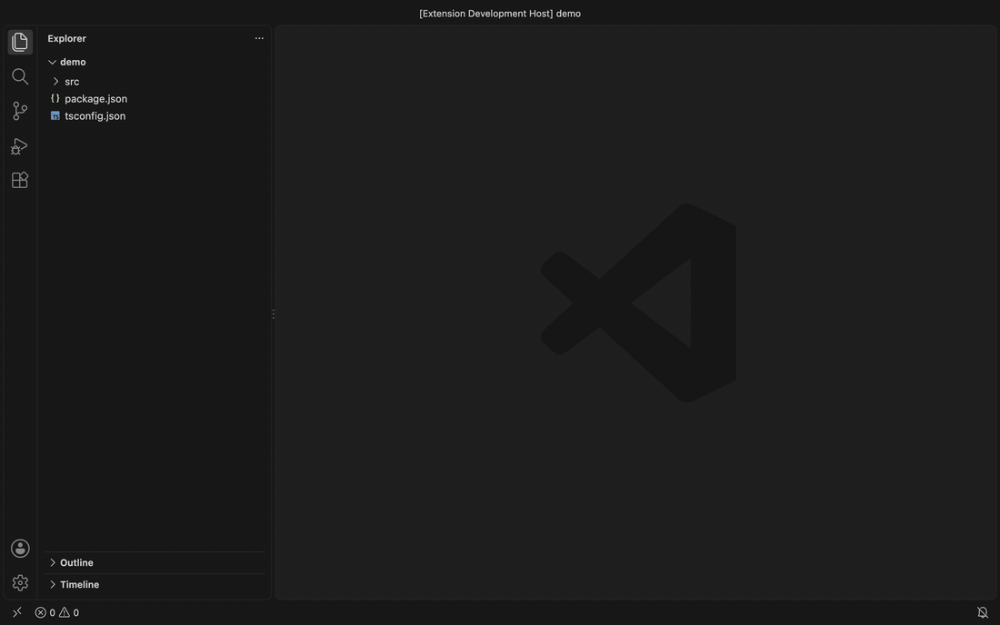

## Highlights

- [CamelHumps and qualified names](#query-syntax): `USI` finds `UserServiceImpl`, `UserService#save`
  finds the method.
- [Recently used results first](#ranking) among equally good matches.
- [Search in a file](#navigation): drill into a file's symbols and back without leaving the search.
- [Copy reference](#copying): `com.acme.user.UserService#save` or `path:line`, without opening it.
- [Opens before indexing ends](#beyond-the-index): the language servers fill in what the index
  does not have yet, and libraries are one key away.
- [Follows `git checkout`](#indexing-and-cache) and other changes made outside VS Code.
- [Go and Java presets](#go-and-java) for include and exclude patterns and method names.

## Install

- [Visual Studio Marketplace](https://marketplace.visualstudio.com/items?itemName=tranphucbol.jetbrain-search-everywhere)
- [Open VSX](https://open-vsx.org/extension/tranphucbol/jetbrain-search-everywhere)

Or run `ext install tranphucbol.jetbrain-search-everywhere` from the command palette quick open
(`cmd + p` / `ctrl + p`).

> Coming from `kbysiec.vscode-search-everywhere`? This extension is a fork of it and keeps the
> same `searchEverywhere.*` settings and command IDs, so your settings carry over. Uninstall or
> disable the original, otherwise both register the same commands and keybindings.

## Quick start

1. Press `alt + cmd + p` (mac) or `ctrl + alt + p` (win/linux). The search opens at once and the
   workspace is indexed in the background; until it finishes, symbols not indexed yet come from
   the language servers. Set `searchEverywhere.shouldInitOnStartup` to index on startup instead.
2. Type part of a file or symbol name and press `enter` to open it.
3. Press `cmd + enter` / `ctrl + enter` to open it to the side, or `alt + right` on a file to
   search the symbols inside it.
4. Type `?` to list the categories, filter phrases and the `>` / `%` prefixes.

## How it works

The extension indexes the workspace into an embedded SQLite database (`sql.js`, WebAssembly):
every file matching the include and exclude patterns, and every symbol the language's document
symbol provider reports for it. Each query runs against B-tree indexes and returns at most 500
ranked results, so the quick pick stays responsive on large workspaces.

After the first scan the index is kept up to date as you work:

- functions, classes, variables or React components added, renamed or deleted in a file
- files added, renamed, deleted or moved between directories or folders of a multi-root workspace
- files created, changed or deleted outside VS Code: by `git checkout`, `git pull`, a code
  generator or a terminal command

The index is cached, so the next start of VS Code reads it instead of scanning again, and changes
made while VS Code was closed are picked up in the background. Git worktrees and local clones of
the same repository share one cache.

The search does not wait for the index: see [Beyond the index](#beyond-the-index) for what it asks
the language servers while indexing, and for libraries, commands and text search.

## Features

### Query syntax

| Query | Finds |
| :--- | :--- |
| `USI`, `usi`, `SerImp` | `UserServiceImpl` (CamelHumps) |
| `UserService.save`, `UserService#save`, `Outer::Inner::run` | a member through its container |
| `UserService.` | every member of `UserService` |
| `src/models/User`, `models/User.find` | names inside a directory |
| `impl user` | `UserServiceImpl` (words in any order) |
| `user*impl` | `UserServiceImpl` (wildcard) |
| `HTTPServer.ts:13`, `src/user.ts:10:5` | opens the item at that line and column |
| `@@order` | types only: classes, enums, interfaces, structs (category) |
| `!!save` | members only: methods, fields, constructors, functions… (category) |
| `$$order` | files only (category) |
| `tab` / `shift + tab`, or a category button | switches between All and each category |
| `>sort` | VS Code commands: opens the command palette with `sort` ([more](#beyond-the-index)) |
| `%TODO` | text in files: opens VS Code's text search with `TODO` ([more](#beyond-the-index)) |
| `?` | the list of categories, filter phrases and `>` / `%` |

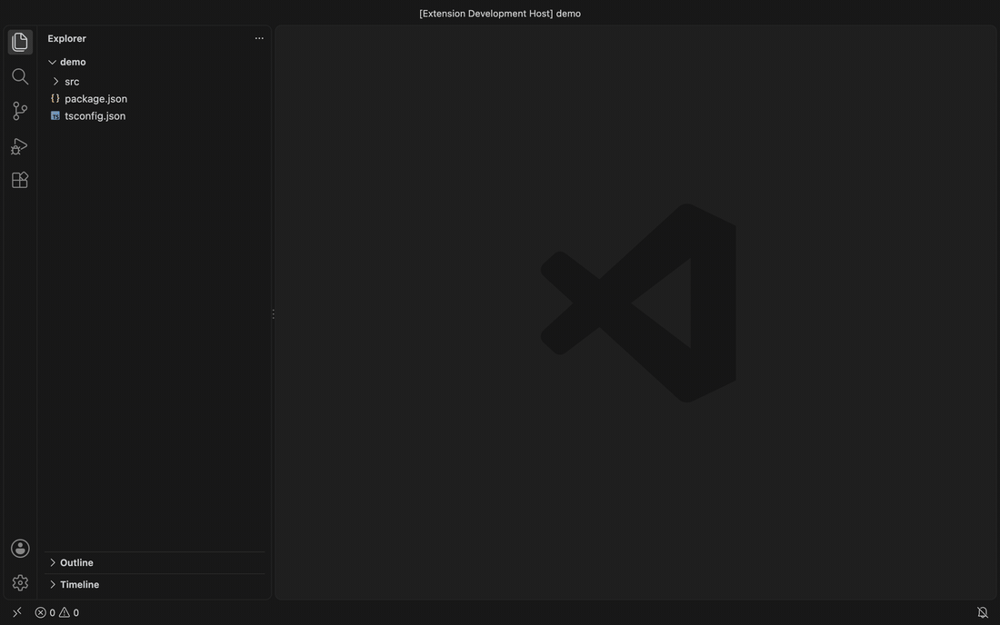

- **CamelHumps**: a query with a capital after its first letter, or with `_` or `-` between its
  parts, matches each part against the start of a word, in order, skipping words in between
  (`USI`, `uSerImp` or `SerImp` find `UserServiceImpl`, `HTTPSer` finds `HTTPServer`, `MV` and
  `max_v` find `MAX_VALUE`). Matches that start at the first word rank above matches that start
  later. An all-lowercase query of two or more characters also matches one letter per word
  (`usi` finds `UserServiceImpl`). CamelHumps matches rank after prefix matches and before
  substring matches.
- **Qualified names**: search a member through its class or namespace with `.`, `#` or `::`. End
  the query with a separator (`UserService.`) to list every member of that container. Members
  under the exact parent rank above members found deeper in the container chain, and an exact
  file match such as `user.service.ts` still comes first.
- **Directory + name**: a query with `/` matches the part after the last `/` against names inside
  that directory, then falls back to matching the path.
- **Multi-word search**: space-separated words match in any order. Every word must match; exact
  and in-order matches rank first.
- **Wildcards**: `*` is the only wildcard. It matches any run of characters within a word, in
  order (`user*impl` finds `UserServiceImpl`, `impl*user` does not). `?`, `%` and `_` match
  literally inside a query; a leading `>` or `%` is a [hand-off](#beyond-the-index). Queries
  containing `/` use the directory search instead of multi-word and `*` matching.
- **Jump to line**: append `:line` or `:line:column` to the query to open the selected item at
  that position.

  

- **Categories**: start the query with a category phrase to search one group of item types:
  `@@` Types (classes, enums, interfaces, structs), `!!` Members (methods, properties, fields,
  constructors, functions, variables, constants, enum members, events, operators) and `$$` Files.
  Press `tab` / `shift + tab` to cycle All → Types → Members → Files; the query keeps its text and
  only the leading phrase changes. Or click a category button: All and one button per category
  sit next to the input as toggles (VS Code 1.109 and later), with the active one pressed, and in
  the title bar before 1.109, with a check on the active one. The title names the active category:
  `Search Everywhere` for All, `Search Everywhere · Types` for Types. After a click the keyboard
  focus is on the results list, where arrows, `enter` and `alt + arrow` keys work; click the input
  to type again. Categories are configurable with `searchEverywhere.categories`.

  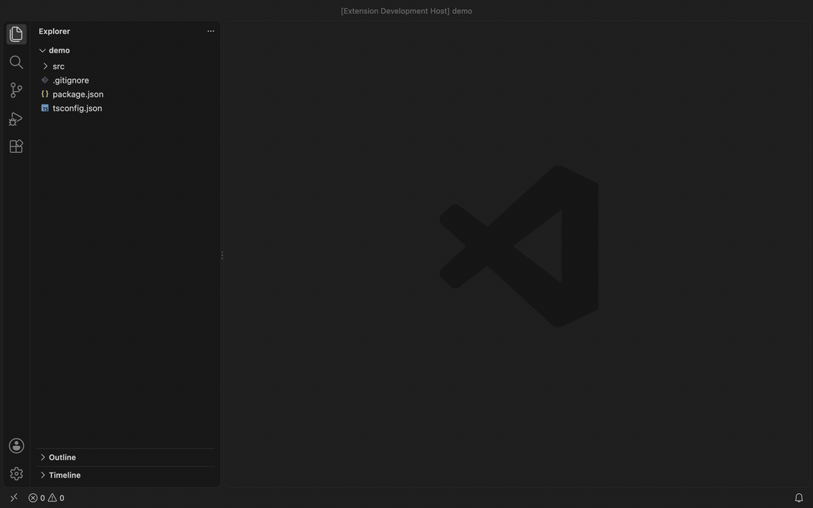

- **Filter phrases**: map a phrase to a single item type with
  `searchEverywhere.itemsFilterPhrases` (none by default). When a phrase is used by both, the
  category wins. Type the help phrase (`?`, `searchEverywhere.helpPhrase`) to list the categories
  and phrases.

  

### Beyond the index

- **Commands and text**: type `>` as the first character to open VS Code's command palette with
  the rest of the query (`>sort` lists the sort commands), or `%` to open VS Code's text search
  with it (`%TODO`). On VS Code versions without the quick text search, `%` opens the Search view
  with the query. Reopening Search Everywhere shows the query without the prefix. A category or
  filter phrase that starts with the same character wins, and a selection or restored query that
  starts with one is still searched here. Turn it off with `searchEverywhere.handOffPrefixes`.

  

- **Not indexed yet**: the search opens at once, even before the first index finishes. While the
  workspace is indexing, each query of two or more characters is also sent to the language
  servers' workspace symbol search, and symbols the index does not have yet are listed after the
  indexed results under `Not indexed yet`. They are never written to the index. Turn it off with
  `searchEverywhere.searchLanguageServersWhileIndexing`.
- **Include libraries**: press `alt + cmd + p` / `ctrl + alt + p` again while the search is open,
  or click the library button in its title, to also search symbols outside the indexed files:
  the JDK and dependencies, `node_modules`, the Go standard library. They are listed after the
  workspace results under `Libraries`, and the title ends with `including libraries`. The toggle
  is off each time the search opens. What it finds depends on the language server: jdtls covers
  the JDK and the project's dependencies, gopls covers dependencies with its default
  `symbolScope` of `all`, and the TypeScript server covers what the project loads, such as
  `lib.*.d.ts` and imported packages, once `typescript.workspaceSymbols.excludeLibrarySymbols`
  is `false` (it is `true` by default).

  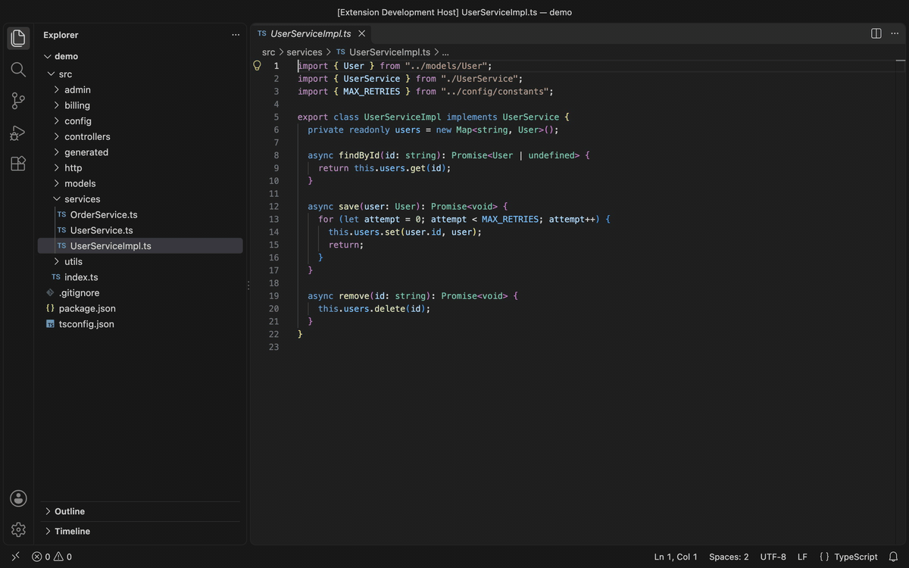

### Ranking

- Results are ranked by how well they match: exact, then prefix, then CamelHumps, then substring.
- **Recently used results first**: while you type, files and symbols you opened recently, and
  open editor tabs, come first among results that match equally well. Typing `index` in a
  monorepo puts the `index.ts` you were just working in above the other `index.ts` files. Recency
  never beats a better match: an exact match you never opened stays above a recent prefix match.
  Turn it off with `searchEverywhere.rankRecentItemsHigher`.
- **Recent items on an empty query**: with nothing typed, the quick pick lists recently opened
  items and open editors.

  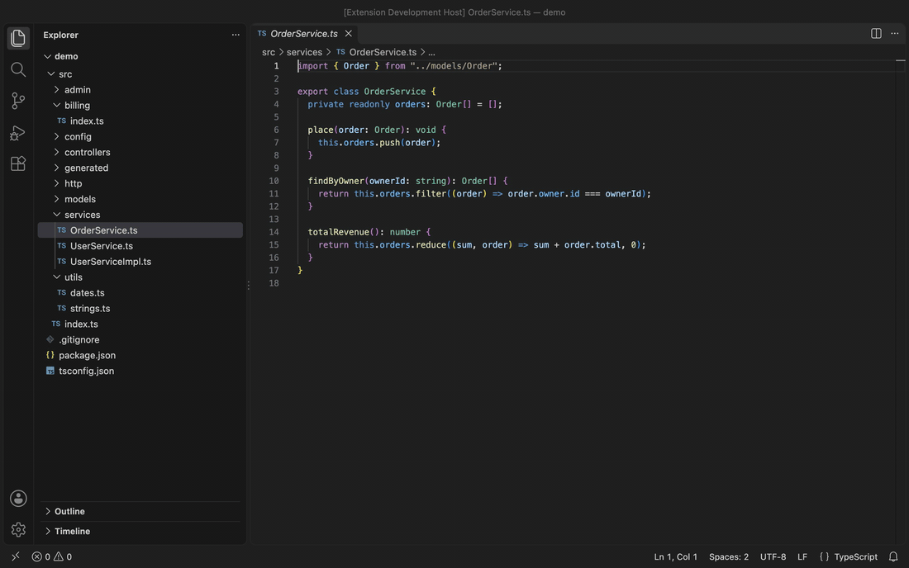

- **Tests, mocks and generated code last**: files matching `searchEverywhere.secondaryCode`
  (`*_test.go`, `mock_*.go`, `*.pb.go`, `src/test/**`, `*.spec.ts` and similar) and their symbols
  rank after source code that matches equally well, and are tagged `· test` or `· generated`. They
  are never hidden, and a better match still wins: an exact match in a test file stays above a
  prefix match in source code. A recently used test row keeps its place among the recent rows.
- Set `searchEverywhere.shouldItemsBeSorted` to group results by item type instead of ranking
  them strictly by relevance.

### Navigation

- **Search in a file**: drill into any file with `alt + right` or the right-arrow button on a
  file item to search the symbols inside it, and go back to the workspace search with
  `alt + left` or the Back button; your previous query is restored.
  `searchEverywhere.searchCurrentFile` (`alt + cmd + o` / `ctrl + alt + o`) opens the search
  scoped to the active editor.

  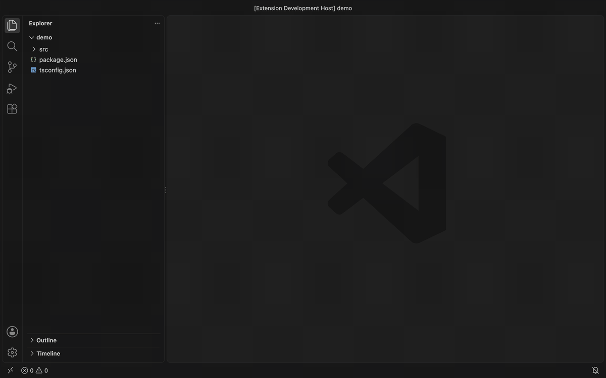

- **Open to the side**: open the selected item in an editor beside the active one with
  `cmd + enter` / `ctrl + enter`, `alt + enter`, or the split-editor button on the item.

  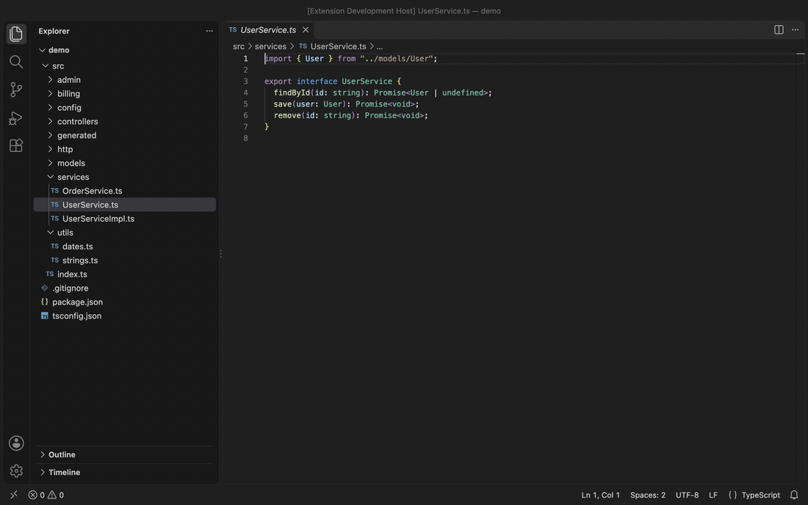

- **Highlight of the selected symbol** (`searchEverywhere.shouldHighlightSymbol`)

  enabled

  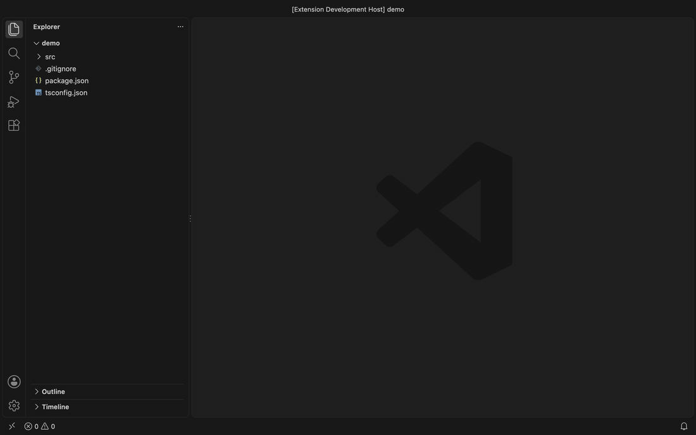

  disabled

  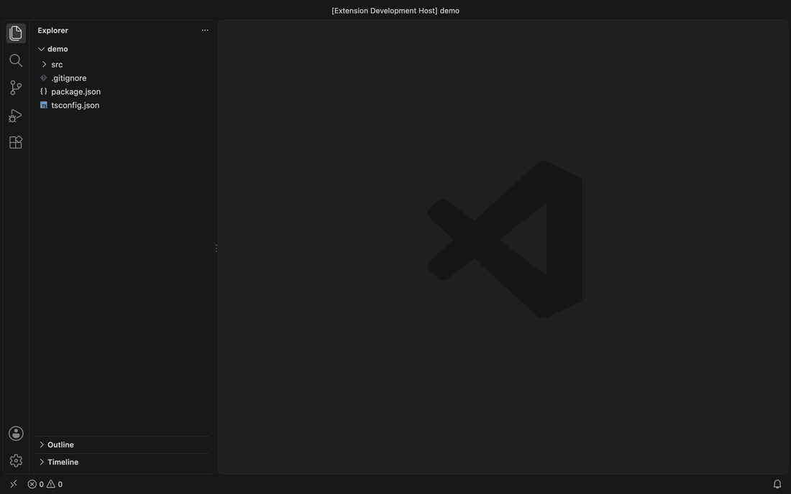

- **Preview while browsing**: moving through the results opens the highlighted file or symbol in a
  preview editor without leaving the quick pick (`searchEverywhere.previewOnSelect`). Press
  `escape` to go back to the editor and cursor you started from; press `enter` to keep it.
- **Last query restored**: reopening Search Everywhere puts the last workspace query back,
  selected, so typing replaces it (`searchEverywhere.restoreLastQuery`).
- The selection in the active editor is put in the search
  (`searchEverywhere.shouldSearchSelection`); a non-empty selection wins over the last query.

### Copying

- **Copy reference**: the copy button on a result, or `alt + shift + cmd + c` /
  `ctrl + alt + shift + c`, copies a reference to it without opening it, ready to paste into a
  review comment, a ticket or a prompt. The quick pick stays open, so you can copy several in a
  row, and the status bar shows what was copied.

  | Result | Reference |
  | :--- | :--- |
  | Java or Kotlin member | `com.acme.user.UserService#save` |
  | Java or Kotlin type | `com.acme.user.User.Builder` |
  | Go method or function | `api.Server.Start`, `api.NewServer` (the form `go doc` accepts) |
  | any other symbol | `UserService.save` |
  | file | `src/user/service.ts`, the workspace-relative path |

- **Copy path and line**: `alt + cmd + c` / `ctrl + alt + c` copies the result's
  workspace-relative path and line, as shown under it (`src/user/service.ts:42`); a file copies
  its path alone. In a multi-root workspace the path starts with the folder name.

  

### Indexing and cache

**What is indexed**

- Index on startup or on the first search (`searchEverywhere.shouldInitOnStartup`).
- Choose what is indexed: include and exclude globs, or VS Code's "Files: Exclude" and
  "Search: Exclude", or the `.gitignore` file (`searchEverywhere.excludeMode`).
- Drop item kinds or names from the index with `searchEverywhere.itemsFilter`,
  `searchEverywhere.excludeProperties` and `searchEverywhere.excludeVariables`.
- Config and data files (`json`, `yaml`, `xml`, `properties`, `md`, `go.mod`, …) are indexed by
  file name only and never sent to a language server (`searchEverywhere.indexNamesOnly`).
- Before indexing, the extension opens one file per language and waits until its language server
  returns symbols: up to 15 s, or 120 s for Java and Kotlin, whose servers import the build first.
  Files indexed without symbols while their language server was still starting are retried every
  30 s for 10 minutes. A language no installed extension provides (`.proto` without a protobuf
  extension) is not waited for.

**Keeping it current**

- The index records each file's modification time and size. On startup a cached index is compared
  with the disk in the background, and only files added, changed or deleted since are reindexed;
  when more than a quarter of the files changed (at least 2000), the workspace is indexed again.
- Files created, changed or deleted outside VS Code are reindexed about half a second after the
  last change (`searchEverywhere.watchFileSystem`). Files open in an editor follow the editor
  instead, and a burst of more than 1000 changes, such as switching branches, is handled like a
  startup comparison.
- A worktree seeded from the shared cache reindexes the files that differ from the worktree the
  cache was written in: `git diff` between the two commits plus both worktrees' uncommitted files.

**Saving and sharing**

- The index is cached between sessions (`searchEverywhere.shouldWorkspaceDataBeCached`) and shared
  across git worktrees and local clones of the same repository
  (`searchEverywhere.shareCacheAcrossWorktrees`).
- The index is saved in the background about 10 s after the last change and again when VS Code
  closes, through a temporary file so a crash never leaves a half-written index. An unchanged
  index is not written. The shared worktree cache is refreshed after a full index, and on exit
  when the index has not changed since the last background save. An index file that cannot be
  read is moved aside and the workspace is reindexed.
- A dedicated output channel logs triggered actions, scanned directories, indexing times, the
  detected language presets and the effective include and exclude patterns.

### Go and Java

- **Language presets**: when a workspace folder has `go.mod` or `go.work` at its root, or
  `pom.xml`, `build.gradle`, `build.gradle.kts` or `settings.gradle*`, the matching preset fills
  the include and exclude patterns and the ignored kinds you have not set yourself at any level
  (user, workspace or folder):

  | Preset | include | exclude adds | ignored kinds |
  | :--- | :--- | :--- | :--- |
  | Go | `**/*.{go,mod,work,proto,yaml,yml,json}` | `**/vendor/**`, `**/bin/**`, `**/testdata/**` | type parameters (25) |
  | Java | `**/*.{java,kt,kts,xml,yml,yaml,properties,gradle,sql}` | `**/target/**`, `**/build/**`, `**/.gradle/**`, `**/.idea/**` | |

  A workspace with both markers gets the union. Without a marker the defaults apply. Adding or
  removing a marker file reindexes the workspace. Turn presets off with
  `searchEverywhere.languagePresets`.
- **Go methods** are stored by their name with the receiver type as container: gopls reports
  `(*Server).Start`, which is found by `Start` or `Server.Start` and shown as
  `Start   (*Server) · method`.
- **Java methods and constructors** drop the parameter list from the name: jdtls reports
  `save(User)`, which is found by `save` or `UserService.save` and shown as
  `save   UserService · method (User)`.
- **Rows** show the name, then the container and kind, and on the second line the `path:line` of
  the symbol's name. The buttons on a row are search in this file (files only), open to the side
  and copy reference.

### Display

- **Indexing notification** in a toast or in the status bar
  (`searchEverywhere.shouldDisplayNotificationInStatusBar`)

  toast

  

  status bar

  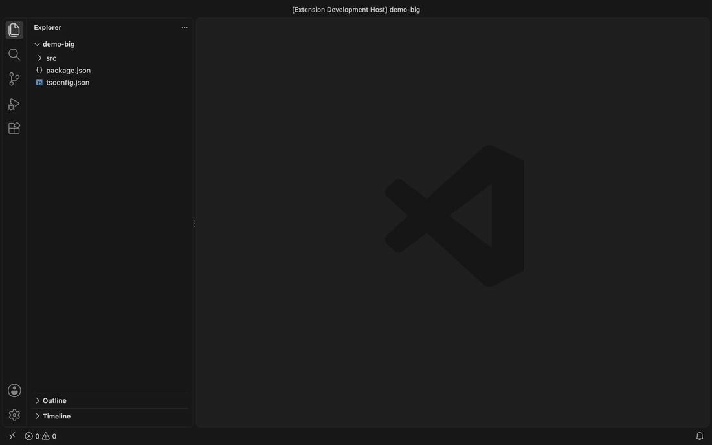

- **Debounce** of search results while typing (`searchEverywhere.shouldUseDebounce`), useful on
  large workspaces

  enabled

  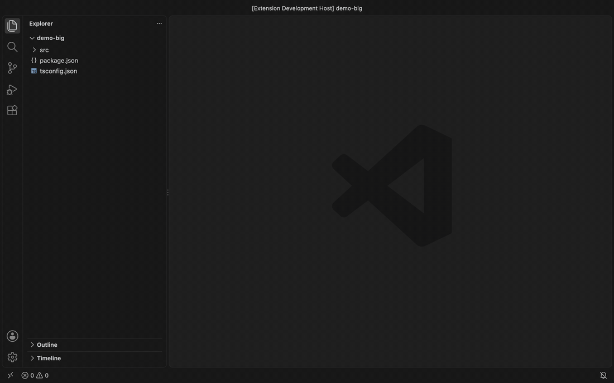

  disabled

  

- A configurable icon for each item type (`searchEverywhere.icons`), or file icons from the
  active file icon theme (`searchEverywhere.useFileIconTheme`).

## Performance

`node scripts/benchmark.js` indexes 50,000 generated files and symbols and runs 170 queries
against them. Measured on an Apple M4:

| | In-memory array (v2.x design) | SQLite WASM index |
| :--- | :---: | :---: |
| JS heap used by the items | +46.6 MB | ~0 MB (rows live in the 38 MB database) |
| Cache | 18.2 MB of JSON in workspace state, 41 ms to write and read | the SQLite database, saved in 45 ms |
| Average query time | 4.45 ms | 2.52 ms (repeated queries come from an LRU cache) |
| Uncached query time | | 9–36 ms, depending on the query |
| Items handed to the quick pick | all 50,000 | at most 500 |

## Commands

| Command | Title | mac | win/linux |
| :--- | :--- | :--- | :--- |
| `searchEverywhere.search` | Search everywhere: Search | `alt + cmd + p` | `ctrl + alt + p` |
| `searchEverywhere.searchCurrentFile` | Search everywhere: Search in Current File | `alt + cmd + o` | `ctrl + alt + o` |
| `searchEverywhere.navigateIntoFile` | Search everywhere: Navigate into File | `alt + right` | `alt + right` |
| `searchEverywhere.navigateBack` | Search everywhere: Navigate Back to Workspace | `alt + left` | `alt + left` |
| `searchEverywhere.openToTheSide` | Search everywhere: Open to the Side | `cmd + enter`, `alt + enter` | `ctrl + enter`, `alt + enter` |
| `searchEverywhere.copyReference` | Search everywhere: Copy Reference | `alt + shift + cmd + c` | `ctrl + alt + shift + c` |
| `searchEverywhere.copyLocation` | Search everywhere: Copy Path and Line | `alt + cmd + c` | `ctrl + alt + c` |
| `searchEverywhere.nextCategory` | Search everywhere: Next Category | `tab` | `tab` |
| `searchEverywhere.previousCategory` | Search everywhere: Previous Category | `shift + tab` | `shift + tab` |
| `searchEverywhere.toggleIncludeLibraries` | Search everywhere: Include Libraries | `alt + cmd + p` (search open) | `ctrl + alt + p` (search open) |
| `searchEverywhere.reload` | Search everywhere: Reload | | |
| `searchEverywhere.clearSharedCache` | Search everywhere: Clear Shared Worktree Cache | | |

- **Search** searches every file and symbol in the workspace.
- **Search in Current File** searches the symbols of the active editor.
- **Navigate into File** searches the symbols of the selected file item; it applies while Search
  Everywhere is open and not already scoped to a file.
- **Navigate Back to Workspace** returns from a file search to the workspace search and restores
  the previous query; it applies while scoped to a file.
- **Open to the Side** opens the selected item beside the active editor; it applies while Search
  Everywhere is open.
- **Copy Reference** and **Copy Path and Line** copy the selected result's reference or
  `path:line` and keep Search Everywhere open; they apply while it is open.
- **Next Category** and **Previous Category** switch between All and each category; they apply
  while Search Everywhere is open and not scoped to a file.
- **Include Libraries** turns library symbols on or off for the open search; it applies while
  Search Everywhere is open.
- **Reload** re-indexes the whole workspace.
- **Clear Shared Worktree Cache** clears the repository cache shared across git worktrees and
  clones.

## Extension Settings

### Indexing

- `searchEverywhere.shouldInitOnStartup`, default `false`

  Should indexing be initialized on Visual Studio Code startup.

- `searchEverywhere.include`, default `"**/*.{js,jsx,ts,tsx}"`

  A glob. Any file matching it is indexed. A [language preset](#go-and-java) replaces the default
  when it is not set.

- `searchEverywhere.indexNamesOnly`, default
  `"**/*.{json,jsonc,yaml,yml,xml,properties,toml,ini,csv,md,txt,lock,sum,mod,work,gradle,sql}"`

  A glob matched against the workspace-relative path. Matching files are indexed as files only;
  their symbols are not requested. Set it to `""` to ask for symbols of every file.

- `searchEverywhere.languagePresets`, default `"auto"`

  `auto` detects Go (`go.mod`, `go.work`) and Java (`pom.xml`, `build.gradle`,
  `build.gradle.kts`, `settings.gradle*`) at each workspace folder root and fills `include`,
  `exclude` and `itemsFilter.ignoredKinds` where you have not set them. `off` keeps the defaults.

- `searchEverywhere.exclude`

  An array of globs. Any file matching these globs is excluded from indexing. A language preset
  adds its excludes to the default when it is not set.

  Default value:

  ```json
  [
    "**/.git",
    "**/.svn",
    "**/.hg",
    "**/.CVS",
    "**/.DS_Store",
    "**/package-lock.json",
    "**/yarn.lock",
    "**/node_modules/**",
    "**/bower_components/**",
    "**/coverage/**",
    "**/.vscode/**",
    "**/.vscode-test/**",
    "**/.history/**",
    "**/.cache/**",
    "**/.cache-loader/**",
    "**/out/**",
    "**/dist/**"
  ]
  ```

- `searchEverywhere.excludeMode`, default `"search everywhere"`

  Which exclude patterns apply: `search everywhere` (`searchEverywhere.exclude`),
  `files and search` (VS Code's "Files: Exclude" and "Search: Exclude") or `gitignore`. If the
  gitignore file is not found or is empty, `searchEverywhere.exclude` is used as a fallback. Run
  `Search everywhere: Reload` after changing the gitignore file.

- `searchEverywhere.itemsFilter`

  A filter applied to items before they are indexed. Kinds are the numbers in the
  [icons table](#icons) below, see also the
  [SymbolKind reference](https://code.visualstudio.com/api/references/vscode-api#SymbolKind).

  Default value:

  ```json
  {
    "allowedKinds": [],
    "ignoredKinds": [],
    "ignoredNames": []
  }
  ```

  This example removes arrays (17), booleans (16) and every item whose name contains `foo`:

  ```json
  {
    "allowedKinds": [],
    "ignoredKinds": [16, 17],
    "ignoredNames": ["foo"]
  }
  ```

- `searchEverywhere.excludeProperties`, default `true`

  Exclude object properties (kind 6). Reduces the index size by more than 50% and removes property
  noise in large codebases. Listing 6 in `itemsFilter.allowedKinds` keeps them.

- `searchEverywhere.excludeVariables`, default `false`

  Exclude variables (kind 12). Disabled by default so newly written variables and React function
  components stay searchable. The TypeScript and JavaScript language server reports `const`
  declarations as variables too, so they are dropped with it; symbols reported as constants
  (kind 13) need 13 in `itemsFilter.ignoredKinds`. Listing 12 in `itemsFilter.allowedKinds`
  keeps variables.

- `searchEverywhere.searchLanguageServersWhileIndexing`, default `true`

  While the workspace is not fully indexed, also ask the language servers' workspace symbol search
  for each query of two or more characters and list symbols the index does not have yet under
  `Not indexed yet`. These results are never written to the index. Does not affect the Include
  libraries toggle. Changing it does not reindex.

### Cache

- `searchEverywhere.shouldWorkspaceDataBeCached`, default `true`

  Index the workspace only once. Each next start of Visual Studio Code reads the index from the
  cache.

- `searchEverywhere.shareCacheAcrossWorktrees`, default `true`

  Share and seed the indexed database cache across git worktrees and local clones of the same
  repository, for a near-instant start. `Search everywhere: Clear Shared Worktree Cache` clears it.

- `searchEverywhere.watchFileSystem`, default `true`

  Watch the workspace for files created, changed or deleted outside Visual Studio Code, such as by
  git, a code generator or a terminal command, and update the index. When `false`, a cached index
  is still compared with the disk on startup. Changing it does not reindex.

### Search and results

- `searchEverywhere.shouldUseDebounce`, default `true`

  Debounce the results while typing; useful in a large workspace.

- `searchEverywhere.shouldSearchSelection`, default `true`

  Put the selection of the active editor in the search.

- `searchEverywhere.previewOnSelect`, default `true`

  Open the highlighted result in a preview editor, without moving focus, while moving through the
  results. `escape` restores the editor and selection that were active before the search opened.

- `searchEverywhere.restoreLastQuery`, default `true`

  Put the last workspace query back, selected, when Search Everywhere opens. A non-empty editor
  selection still wins when `searchEverywhere.shouldSearchSelection` is on.

- `searchEverywhere.handOffPrefixes`, default `true`

  A query typed with `>` as its first character opens the VS Code command palette, and one with
  `%` opens VS Code's text search, with the rest of the query. When `false`, both are searched in
  the index like any other query. Changing it does not reindex.

- `searchEverywhere.secondaryCode`

  An array of globs for tests, mocks and generated code. Matching files and their symbols rank
  after other results of the same match quality and are tagged `· test` (when the glob mentions
  `test` or `spec`) or `· generated`. Changing it does not reindex.

  Default value:

  ```json
  [
    "**/*_test.go",
    "**/mock_*.go",
    "**/mocks/**",
    "**/*.pb.go",
    "**/*_gen.go",
    "**/*.gen.go",
    "**/zz_generated*",
    "**/src/test/**",
    "**/generated/**",
    "**/generated-sources/**",
    "**/__tests__/**",
    "**/*.{test,spec}.{ts,tsx,js,jsx}"
  ]
  ```

- `searchEverywhere.shouldItemsBeSorted`, default `false`

  Group and sort results by item type. When `false` (recommended), results are ranked strictly by
  relevance.

- `searchEverywhere.rankRecentItemsHigher`, default `true`

  Show recently opened files and symbols first among equally good matches while typing.

- `searchEverywhere.showRecentItemsOnEmptyQuery`, default `true`

  Show recent items and open editors when the search query is empty.

- `searchEverywhere.recentItemsLimit`, default `10`

  Maximum number of recent items shown when the search query is empty.

- `searchEverywhere.shouldUseItemsFilterPhrases`, default `true`

  Allow narrowing the results down with the categories and filter phrases below.

- `searchEverywhere.categories`

  Groups of item kinds, each with a phrase. Starting the query with the phrase limits results to
  those kinds, and `tab` / `shift + tab` and the category buttons go through the categories in
  this order. `icon` is the [codicon](https://microsoft.github.io/vscode-codicons/dist/codicon.html)
  id shown on the category's button (lowercase letters, digits and `-`); a missing or invalid
  icon shows `filter`.

  Default value:

  ```json
  [
    { "name": "Types", "phrase": "@@", "kinds": [4, 9, 10, 22], "icon": "symbol-class" },
    { "name": "Members", "phrase": "!!", "kinds": [5, 6, 7, 8, 11, 12, 13, 21, 23, 24], "icon": "symbol-method" },
    { "name": "Files", "phrase": "$$", "kinds": [0], "icon": "files" }
  ]
  ```

- `searchEverywhere.itemsFilterPhrases`, default `{}`

  Phrases that narrow the results down to one item type, keyed by kind, for example
  `{ "11": "ff" }` for functions. A category with the same phrase wins.

- `searchEverywhere.helpPhrase`, default `"?"`

  A phrase that lists the categories and filter phrases.

### Display

- `searchEverywhere.shouldDisplayNotificationInStatusBar`, default `false`

  Show the indexing notification in the status bar instead of a toast.

- `searchEverywhere.shouldHighlightSymbol`, default `false`

  Highlight the selected symbol after opening it.

- `searchEverywhere.useFileIconTheme`, default `false`

  Show file results with icons from the active VS Code file icon theme (e.g. Seti, Material Icon
  Theme) instead of the built-in icon. Symbols keep their built-in icons. Requires VS Code 1.108
  or newer; older versions keep the built-in icon.

- `searchEverywhere.icons`

  <a id="icons"></a>The icon displayed for each item type. Only
  [codicons](https://code.visualstudio.com/api/references/icons-in-labels#icon-listing) are
  allowed; an item type left out has no icon.

  Default value:

  ```json
  {
    "0": "symbol-file",
    "1": "file-submodule",
    "2": "symbol-namespace",
    "3": "package",
    "4": "symbol-class",
    "5": "symbol-method",
    "6": "symbol-property",
    "7": "symbol-field",
    "8": "symbol-constructor",
    "9": "symbol-enum",
    "10": "symbol-interface",
    "11": "symbol-function",
    "12": "symbol-variable",
    "13": "symbol-constant",
    "14": "symbol-string",
    "15": "symbol-numeric",
    "16": "symbol-boolean",
    "17": "symbol-array",
    "18": "symbol-keyword",
    "19": "symbol-key",
    "20": "remove",
    "21": "symbol-enum-member",
    "22": "symbol-structure",
    "23": "symbol-event",
    "24": "symbol-operator",
    "25": "type-hierarchy-sub"
  }
  ```

  Which kind refers to which item type:

  | kind | icon               | item type      |
  |------|:------------------:|:--------------:|
  |   0  | symbol-file        | file           |
  |   1  | file-submodule     | module         |
  |   2  | symbol-namespace   | namespace      |
  |   3  | package            | package        |
  |   4  | symbol-class       | class          |
  |   5  | symbol-method      | method         |
  |   6  | symbol-property    | property       |
  |   7  | symbol-field       | field          |
  |   8  | symbol-constructor | constructor    |
  |   9  | symbol-enum        | enum           |
  |  10  | symbol-interface   | interface      |
  |  11  | symbol-function    | function       |
  |  12  | symbol-variable    | variable       |
  |  13  | symbol-constant    | constant       |
  |  14  | symbol-string      | string         |
  |  15  | symbol-numeric     | number         |
  |  16  | symbol-boolean     | boolean        |
  |  17  | symbol-array       | array          |
  |  18  | symbol-keyword     | object         |
  |  19  | symbol-key         | key            |
  |  20  | remove             | null           |
  |  21  | symbol-enum-member | enum member    |
  |  22  | symbol-structure   | struct         |
  |  23  | symbol-event       | event          |
  |  24  | symbol-operator    | operator       |
  |  25  | type-hierarchy-sub | type parameter |

## Release Notes

See [CHANGELOG.md](CHANGELOG.md).

## Development

```sh
npm install
npm run compile          # clean dist/ and type check
npm test                 # mocha suite inside a downloaded VS Code
node scripts/benchmark.js # search benchmark; run npm run compile first
```

To try the extension, open the repository in VS Code, open the "Run and Debug" view and start
"Run Extension".

## Credits

Created by [Kamil Bysiec](https://github.com/kbysiec)
([kbysiec/vscode-search-everywhere](https://github.com/kbysiec/vscode-search-everywhere)).
This fork is maintained by [tranphucbol](https://github.com/tranphucbol).

If you find it useful, a rating on the
[Marketplace](https://marketplace.visualstudio.com/items?itemName=tranphucbol.jetbrain-search-everywhere&ssr=false#review-details)
or a star on [GitHub](https://github.com/tranphucbol/vscode-search-everywhere) is appreciated.
